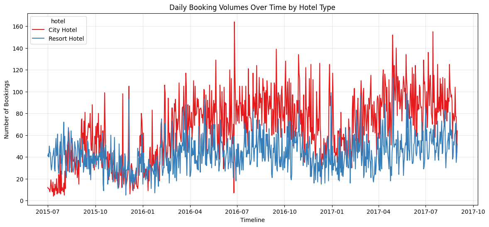
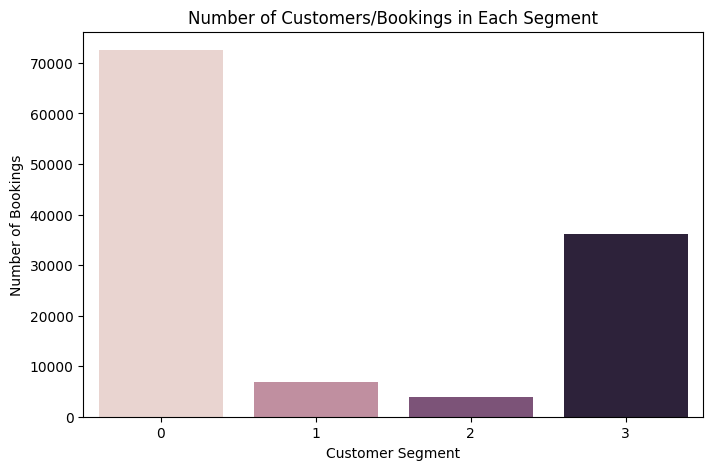
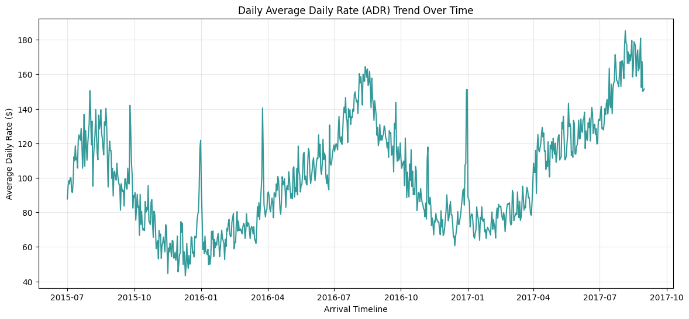
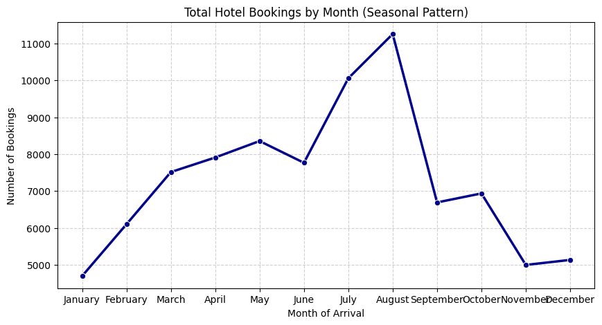

# 🏨 Hotel Booking Analysis using Python

## 📌 Project Overview
This project focuses on analyzing hotel booking data to understand customer booking patterns, cancellation trends, customer segmentation, and revenue-related insights.

The objective is to identify meaningful business insights that can help hotel management improve operational efficiency, reduce cancellations, and enhance customer satisfaction.

## 🎯 Project Objectives
- Analyze hotel booking trends and customer behavior.
- Identify factors influencing booking cancellations.
- Perform customer segmentation analysis.
- Understand the relationship between lead time, length of stay, and cancellations.
- Generate actionable business recommendations.

## 📂 Dataset Description
The dataset contains hotel booking information, including:
- Hotel type
- Booking and arrival dates
- Lead time
- Customer type
- Market segment
- Distribution channel
- Average Daily Rate (ADR)
- Cancellation status
- Special requests

## 🛠️ Tools and Technologies
- Python
- Google Colab
- Pandas
- NumPy
- Matplotlib
- Seaborn

## 🔍 Analysis Performed
1. Data cleaning and preprocessing.
2. Exploratory Data Analysis (EDA).
3. Customer segmentation analysis.
4. Booking and cancellation analysis.
5. Lead time and cancellation relationship.
6. Special requests and cancellation trends.
7. Domestic vs. international guest analysis.
8. Customer booking behavior analysis.

## 💡 Key Business Questions
- Which month has the highest number of bookings?
- Which market segments have the highest cancellation rates?
- How does lead time influence cancellations?
- What is the impact of special requests on cancellations?
- How do domestic and international guests differ in booking behavior?
- Which distribution channel has the highest average ADR?

## 📈 Business Recommendations
- Monitor bookings with longer lead times to identify cancellation risks.
- Improve customer engagement through personalized communication.
- Analyze market segments with higher cancellation rates.
- Use special-request patterns to improve customer satisfaction.
- Optimize pricing and distribution channel strategies.

## 👩‍💻 Author
**Arati Joshi**

Aspiring Data Analyst | Python | SQL | Excel | Power BI

GitHub: https://github.com/Arati-Joshi-Data

## 📊 Project Visualizations

### 1. Daily Booking Volumes Over Time by Hotel Type

### 2.Number of Customers.Bookings in Each Segment

###3. Daily ADR

###4. Total Hotel bookings by month

